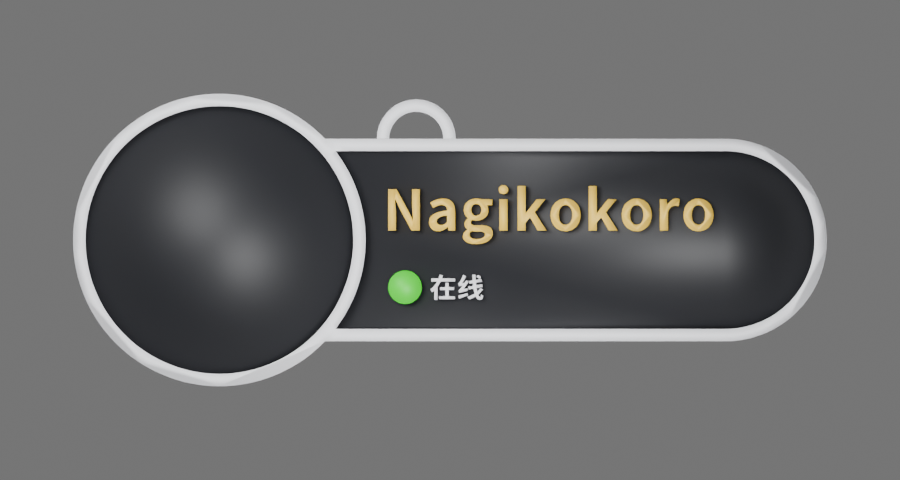
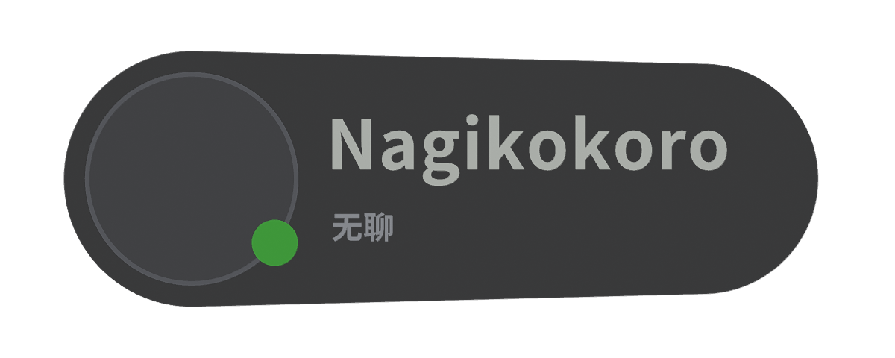

<p align="center"></p>
<h1 align="center">VRC Tag Studio</h1>
<p align="center">VRChat風ネームプレートをブラウザーで作成。リアルタイム3Dプレビュー、マルチカラー3MF、Blender向けGLBに対応します。</p>
<p align="center"><a href="README.md">English</a> · <a href="README.zh-CN.md">简体中文</a> · <strong>日本語</strong> · <a href="README.ko.md">한국어</a></p>
<p align="center"><a href="https://tag.nagikokoro.best/"><strong>Web Studioを開く</strong></a> · <a href="web/README.md">開発ドキュメント</a></p>
<p align="center"><sub>公開ベータ · オープンソース · ログイン不要 · 非公式ファンプロジェクト</sub></p>

---

## スタイルを選ぶ

| Classic · Large Avatar | Native · VRChat Style |
| :---: | :---: |
|  |  |
| 大きなアバター、白い縁、白い芯と黒い表面 | コンパクトなカプセル形状、暗色の本体 |
| **134 × 52 × 3.0 mm** | **118 × 45.6 × 3.7 mm** |

*画像はモデルの参考レンダリングです。色や寸法は設定によって変わる場合があります。*

## 主な機能

- **2種類のスタイル：** Classic / Native、吊り下げループの切り替え、名前の編集。
- **カスタマイズ：** 通常は白文字、フレンドは金文字。Pronouns、ステータス文字、ドットの色も変更可能。
- **リアルタイム3D：** 回転・ズーム、ローカルPNG/JPEG/WebPアバターのプレビュー。
- **マルチカラー3MF：** パーツ別フィラメント情報を含むBambu Studio互換形式と汎用Core 3MF。
- **Blender向けGLB：** パーツ別メッシュ、色、任意のアバター画像を含む。**Blender → ファイル → インポート → glTF 2.0** から開きます。
- **設定の再利用：** JSONの保存と復元。English / 简体中文 / 日本語 / 한국어から表示言語を選択できます。

**プライバシー：** 処理はブラウザー内で完結します。アバター画像は3MFの印刷形状にはなりませんが、GLBに埋め込むことがあるため共有時に注意してください。

## 出力形式

| 形式 | 用途 | 説明 |
| --- | --- | --- |
| **マルチカラー3MF（Bambu）** | Bambu Studio | パーツ別フィラメント情報あり。初期設定は **A1 / 0.4 mm / PLA**。スライス前に機種と材料を選択してください。 |
| **汎用Core 3MF** | 他のスライサー | パーツと色を保持。フィラメント割り当てが必要な場合があります。 |
| **Blender GLB** | 編集・レンダリング | パーツ別メッシュと任意のアバター画像。スライス済みG-codeではありません。 |
| **JSON** | 保存・復元 | 設定のみ。アバター画像は含みません。 |

**印刷機能はベータ版です。** Bambu Studioの読み込み・再保存と一部のスライス検証は完了しましたが、実物印刷や幅広い機種への対応は未検証です。印刷前にレイヤー、細い文字、接合部と材料を確認してください。テスト用G-codeをそのまま印刷しないでください。

## ローカル実行

**Node.js 22.12以上** とnpmが必要です。

```bash
git clone https://github.com/RICHARDwuxiaofei/vrctag.git
cd vrctag/web
npm ci
npm run dev
```

Viteに表示されたURLを開きます。検証とビルド：

```bash
npm run check
npm test
npm run test:review
npm run build
npx vite preview --host 127.0.0.1
```

公開するのは `web/dist/` のみ。サーバー側Blenderやデータベースは不要です。

## Cloudflare Pagesへのデプロイ

**Cloudflare PagesのGit連携**でこのリポジトリを指定します。

| Setting | Value |
| --- | --- |
| Production branch | `main` |
| Root directory | `web` |
| Build command | `npm run build` |
| Build output directory | `dist` |
| Environment variable | `NODE_VERSION=22` |

Git Push後はCloudflareが自動的にビルド・公開します。GitHub ActionsやバックエンドWorkerは不要です。[デプロイ手順](docs/CLOUDFLARE_PAGES_DEPLOY.md)。

## ソース構成

`web/` にReact/TypeScript/Vite/Three.js、`studio/classic.blend` と `studio/native.blend` にモデル元データ、`studio/scripts/` に生成・検証ツールがあります。旧Python/Blender版は履歴用に残しますが、Web版には含まれません。

## ライセンスと表示

独自コードは **[MIT](LICENSE)**。現行Classic/Nativeモデルのうち作者が権利を持つ部分は **[CC BY 4.0](LICENSES/CC-BY-4.0.txt)**、表示名は **RICHARDwuxiaofei — VRC Tag Studio**。NotoフォントはSIL OFL 1.1、Bambu Studioのプリセットは元のAGPL条件に従います。過去のWiseWolf由来の素材は従来のCC BY-NC-SA 4.0と著作権表示を維持します。

[License scope](LICENSE_SCOPE.md) · [Third-party notices](THIRD_PARTY_NOTICES.md) · [License migration](docs/LICENSE_MIGRATION.md)

**本プロジェクトはVRChatやBambu Labの公式製品・提携・後援ではありません。**
