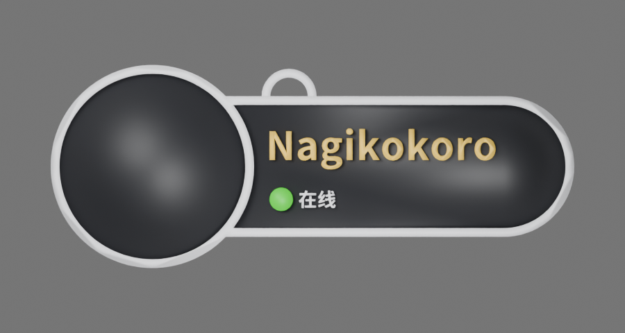
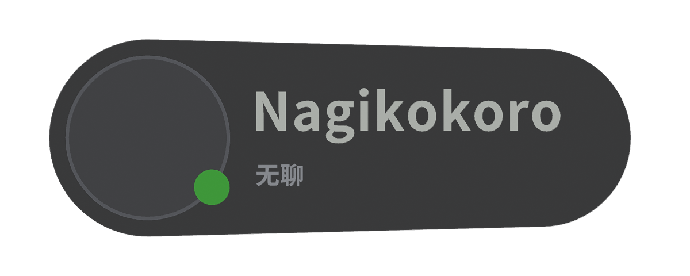

<p align="center"></p>
<h1 align="center">VRC Tag Studio</h1>
<p align="center">브라우저에서 VRChat 스타일 네임플레이트를 만들고 3D로 미리 본 뒤 다색 3MF 또는 Blender GLB로 내보내세요.</p>
<p align="center"><a href="README.md">English</a> · <a href="README.zh-CN.md">简体中文</a> · <a href="README.ja.md">日本語</a> · <strong>한국어</strong></p>
<p align="center"><a href="https://tag.nagikokoro.best/"><strong>웹 스튜디오 열기</strong></a> · <a href="web/README.md">개발 문서</a></p>
<p align="center"><sub>공개 베타 · 오픈 소스 · 로그인 불필요 · 비공식 팬 프로젝트</sub></p>

---

## 스타일 선택

| Classic · Large Avatar | Native · VRChat Style |
| :---: | :---: |
|  |  |
| 큰 아바타, 흰색 테두리, 흰색 코어와 검은 앞면 | 컴팩트한 캡슐 디자인과 어두운 본체 |
| **134 × 52 × 3.0 mm** | **118 × 45.6 × 3.7 mm** |

*이미지는 참고 렌더링이며 색상과 크기는 선택한 모델 설정에 따라 달라질 수 있습니다.*

## 주요 기능

- **두 가지 스타일:** Classic/Native 전환, 상단 고리 설정, 이름 편집.
- **개인 설정:** 일반 흰색 / 친구 금색 이름, Pronouns, 상태 문구와 상태 점 색상.
- **실시간 3D:** 회전·확대/축소, 로컬 PNG/JPEG/WebP 아바타 미리 보기.
- **다색 3MF:** 부품별 필라멘트 정보가 포함된 Bambu Studio 호환 형식과 범용 Core 3MF.
- **Blender GLB:** 분리된 메시, 색상, 선택한 아바타 이미지 포함. **Blender → 파일 → 가져오기 → glTF 2.0**으로 불러올 수 있습니다.
- **설정 복원:** JSON 저장/불러오기. UI 언어는 English / 简体中文 / 日本語 / 한국어 중에서 선택할 수 있습니다.

**개인정보:** 모델과 아바타 처리는 브라우저 내부에서 수행됩니다. 아바타 사진은 3MF의 인쇄용 형상이 아니지만 GLB에 포함될 수 있으므로 공유 시 주의하세요.

## 내보내기 형식

| 형식 | 용도 | 설명 |
| --- | --- | --- |
| **다색 3MF (Bambu)** | Bambu Studio | 부품별 필라멘트 정보 포함. 기본 **A1 / 0.4 mm / PLA** 설정을 실제 프린터 및 재료에 맞게 변경하세요. |
| **범용 Core 3MF** | 다른 슬라이서 | 부품과 색상을 보존하지만 필라멘트 배정이 필요할 수 있습니다. |
| **Blender GLB** | 편집·렌더링 | 분리된 메시와 선택한 아바타 이미지. 슬라이싱된 G-code는 아닙니다. |
| **JSON** | 설정 저장·복원 | 아바타 사진 없이 디자인 설정만 저장합니다. |

**인쇄 기능은 베타입니다.** Bambu Studio 불러오기/다시 저장하기와 일부 슬라이싱 검사는 통과했지만 실제 출력 품질과 폭넓은 기기 호환성은 검증되지 않았습니다. 출력 전 레이어, 얇은 글자, 연결부, 소재 배정을 확인하고 테스트용 G-code를 그대로 사용하지 마세요.

## 로컬 실행

**Node.js 22.12 이상**과 npm이 필요합니다.

```bash
git clone https://github.com/RICHARDwuxiaofei/vrctag.git
cd vrctag/web
npm ci
npm run dev
```

Vite에 표시된 URL을 여세요. 검사 및 빌드:

```bash
npm run check
npm test
npm run test:review
npm run build
npx vite preview --host 127.0.0.1
```

배포에는 `web/dist/`만 필요하며 서버 측 Blender나 데이터베이스는 없습니다.

## Cloudflare Pages 배포

**Cloudflare Pages Git 연동**을 사용하여 저장소를 연결하세요.

| Setting | Value |
| --- | --- |
| Production branch | `main` |
| Root directory | `web` |
| Build command | `npm run build` |
| Build output directory | `dist` |
| Environment variable | `NODE_VERSION=22` |

Git Push 후 Cloudflare가 자동으로 빌드·배포합니다. GitHub Actions나 백엔드 Worker는 필요하지 않습니다. [배포 안내](docs/CLOUDFLARE_PAGES_DEPLOY.md).

## 프로젝트 구조

`web/`은 React/TypeScript/Vite/Three.js 앱, `studio/classic.blend`와 `studio/native.blend`는 모델 원본, `studio/scripts/`는 생성 및 검증 도구입니다. 이전 Python/Blender 버전은 기록과 호환성을 위해 남아 있으나 웹 빌드에는 포함되지 않습니다.

## 라이선스 및 출처

독자적인 코드는 **[MIT](LICENSE)**, 저작자가 권리를 가진 현재 Classic/Native 모델 부분은 **[CC BY 4.0](LICENSES/CC-BY-4.0.txt)**이며 **RICHARDwuxiaofei — VRC Tag Studio**로 표기합니다. Noto 폰트는 SIL OFL 1.1, Bambu Studio 프리셋은 원래 AGPL 조건을 따릅니다. 과거 WiseWolf 기반 자료에는 기존 CC BY-NC-SA 4.0 및 출처 표시 조건이 계속 적용됩니다.

[License scope](LICENSE_SCOPE.md) · [Third-party notices](THIRD_PARTY_NOTICES.md) · [License migration](docs/LICENSE_MIGRATION.md)

**이 프로젝트는 VRChat 또는 Bambu Lab의 공식 제품이 아니며 제휴나 후원을 받지 않습니다.**
