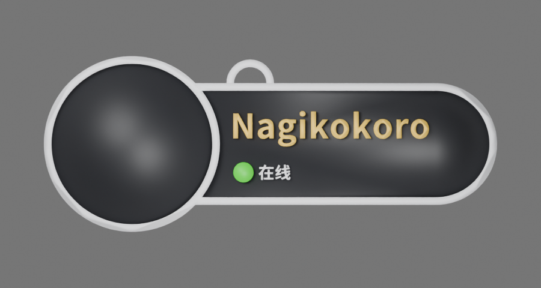
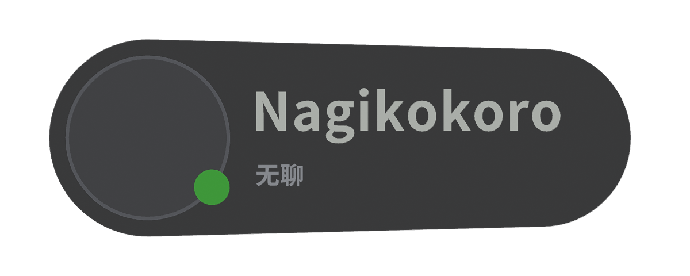

<p align="center"></p>
<h1 align="center">VRC Tag Studio</h1>
<p align="center">Create VRChat-inspired nameplates in your browser — live 3D preview, multicolor 3MF printing exports and editable Blender GLB.</p>
<p align="center">**English** · [简体中文](README.zh-CN.md) · [日本語](README.ja.md) · [한국어](README.ko.md)</p>
<p align="center"><a href="https://tag.nagikokoro.best/"><strong>Launch VRC Tag Studio</strong></a> · <a href="web/README.md">Developer docs</a></p>
<p align="center"><sub>Public beta · Open source · No account required · Unofficial VRChat fan project</sub></p>

---

## Choose your style

| Classic · Large Avatar | Native · VRChat Style |
| :---: | :---: |
|  |  |
| Large avatar, white rim, white core with black face | Compact capsule and dark solid body |
| **134 × 52 × 3.0 mm** | **118 × 45.6 × 3.7 mm** |

*Preview images are model renders. Colors and dimensions are subject to the selected configuration.*

## Features

- **Two styles:** Classic and Native, with optional hanging loop and customizable display name.
- **Personalization:** White standard name / gold friend name, pronouns, status text and colored status dot.
- **Real-time 3D:** Rotate, zoom and preview a local PNG/JPEG/WebP avatar.
- **Multicolor 3MF:** Bambu Studio-compatible export with part/filament mapping, plus generic Core 3MF.
- **Blender-ready GLB:** Export separate mesh parts, colors and an optional embedded avatar photo. Import through **Blender → File → Import → glTF 2.0**.
- **Reusable configuration:** Save and restore a JSON design. Switch UI languages among English, 简体中文, 日本語 and 한국어.

**Privacy:** Nameplate generation and avatar handling run in the browser. The avatar photo is not printable 3MF geometry, but can be embedded in GLB files. Take care when sharing exported GLBs.

## Export options

| Format | Use | Details |
| --- | --- | --- |
| **Multicolor 3MF (Bambu)** | Bambu Studio | Per-part filaments; starts from an **A1 / 0.4 mm / PLA** profile. Choose your own printer and material before slicing. |
| **Generic Core 3MF** | Other slicers | Printable separate parts and colors; manual filament mapping may be needed. |
| **Blender GLB** | Model editing/rendering | Editable parts and optional avatar texture; not sliced G-code. |
| **JSON** | Save/restore | Design parameters only; no avatar picture. |

**Printing is still beta.** Bambu Studio import/round-trip and limited slicing checks passed, but physical prints and broad printer compatibility are not fully verified. Check layer previews, thin text, connections and materials before printing. Do not run bundled test G-code.

## Run locally

Requires **Node.js 22.12+** and npm.

```bash
git clone https://github.com/RICHARDwuxiaofei/vrctag.git
cd vrctag/web
npm ci
npm run dev
```

Open Vite's local URL. Verify and build:

```bash
npm run check
npm test
npm run test:review
npm run build
npx vite preview --host 127.0.0.1
```

Only `web/dist/` is needed for hosting; there is no backend, database or server-side Blender.

## Deploy to Cloudflare Pages

Connect this repository through **Cloudflare Pages → Git integration**:

| Setting | Value |
| --- | --- |
| Production branch | `main` |
| Root directory | `web` |
| Build command | `npm run build` |
| Build output directory | `dist` |
| Environment variable | `NODE_VERSION=22` |

Cloudflare handles builds and deployments after Git pushes. No GitHub Actions or backend Workers are required. See [deployment instructions](docs/CLOUDFLARE_PAGES_DEPLOY.md).

## Project structure

`web/` contains React, TypeScript, Vite and Three.js; `studio/classic.blend` and `studio/native.blend` are model sources, with tools in `studio/scripts/`. The original Python/Blender desktop generator remains in the repository but is **not** included in the web deployment.

## License & credits

Original code: **[MIT](LICENSE)**. Author-owned contributions to current Classic and Native models: **[CC BY 4.0](LICENSES/CC-BY-4.0.txt)**, credit **RICHARDwuxiaofei — VRC Tag Studio**. Noto fonts use SIL OFL 1.1; bundled Bambu Studio preset data retain upstream AGPL terms. Historical WiseWolf-origin resources retain their previous CC BY-NC-SA 4.0 attribution and license. These grants do not relicense third-party rights.

[License scope](LICENSE_SCOPE.md) · [Third-party notices](THIRD_PARTY_NOTICES.md) · [License migration](docs/LICENSE_MIGRATION.md)

**Unofficial fan project; not affiliated with or endorsed by VRChat or Bambu Lab.**

---

<details><summary>Historical Python + Blender desktop documentation (original attribution retained)</summary>

# vrctag

Generate printable VRC-style name tags with custom text and multicolor 3MF export. No name is preset.

## Attribution and license

Adapted from **[VRC名牌吊牌 by WiseWolf](https://makerworld.com.cn/zh/models/203011-vrcming-pai-diao-pai)** under **[CC BY-NC-SA 4.0](https://creativecommons.org/licenses/by-nc-sa/4.0/)**. Credit the original creator, use noncommercially, and distribute model adaptations under the same license. This version changes the rim, text relief and dot placement and adds automated text, multicolor export and display options. See [ATTRIBUTION.md](ATTRIBUTION.md) and [历史许可证](legacy/LICENSE-before-mit.txt). WiseWolf does not endorse this project.

## Setup

Requires Windows, Python 3 with tkinter, and Blender 4.2 or newer.

Download the repository and keep `nametag_template.blend` beside the script. Run `start.cmd` or `python name_tag_generator.py`. Select your Blender executable and output folder, enter a name and status, then click **Generate**.

Blender runs in the background without MCP. Local preferences are saved in the ignored `settings.json`. Previous exports are preserved using revision numbers.

## Multicolor printing

Open the generated **3MF as a project** in Creality Print and load filament colors. Five parts retain assembly positions and filament assignments:

| Slot | Parts | Color |
| --- | --- | --- |
| 1 | Rim and status text | White |
| 2 | Base | Black |
| 3 | Name | Yellow |
| 4 | Status dot | Based on status |

Select printer and material settings, slice and inspect the preview, then map colors to actual CFS filaments before printing. The 3MF is an unsliced project.

Statuses: `online` (green), `offline` (gray), `busy` / `dnd` (red), `away` (orange). Custom status text is supported.

**3MF only** is enabled by default and creates only the printable 3MF in the result folder. Turn it off for five STL files, an editable Blender file, mesh validation and printing instructions. STL has no colors: import all five together as parts of one object and assign filaments.

The status dot aligns with the left edge of the name and sits immediately before the status text. Text relief is 0.5 mm (half the original 1 mm). The rim has a flat top and vertical sides, without a rounded vertical profile.

Status text and dot color can be selected independently. Choose automatic matching, a status color, or a custom color with the picker / `#RRGGBB` field. VRChat-style colors from [VRCX's official status palette](https://github.com/vrcx-team/VRCX/blob/master/src/styles/globals.css): online `#2ED319`, join me `#00B8FF`, ask me `#E97C03`, busy `#C80928`.

For display use, disable **3MF only**, enable **Avatar image**, and choose a PNG, JPG, JPEG, WebP or BMP. The image is center-cropped into the circular avatar area and packed into the Blender file. View it using Material Preview. It is not converted into printable geometry or included in 3MF/STL. Transparent images are supported. The original image file is no longer needed to open the saved Blender file.

Size: approximately 109.05 × 43.84 × 3.6 mm. Designed for multicolor printing, without snap-fit joints for separate assembly. Long text shrinks automatically; inspect thin strokes in the slicing preview.

## Command line

After configuring Blender in the GUI:

```powershell
python name_tag_generator.py --name "Your name" --status online --output "D:\Tags"
```

Optional flags: `--status-color "join me"` (or `#RRGGBB`), `--full-export`, and `--icon "avatar.png"` (requires `--full-export`).

The template contains only the base, rim and dot, with a packed font supporting Chinese and Latin text. Names and status text are generated from input.

`upgrade_existing.py` creates multicolor copies of old 3MF files in model folders under the repository's parent directory, preserving originals.

</details>
