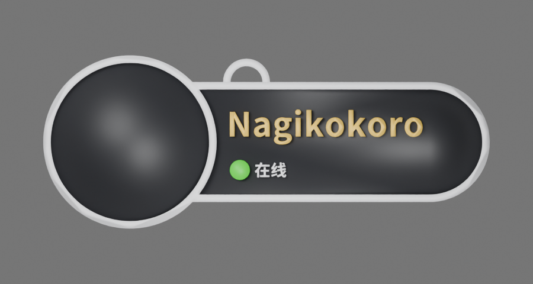

<p align="center"></p>
<h1 align="center">VRC Tag Studio</h1>
<p align="center">在浏览器中制作 VRChat 风格名牌：实时 3D 预览、多色 3MF 打印文件和可编辑 Blender GLB。</p>
<p align="center"><a href="README.md">English</a> · <strong>简体中文</strong> · <a href="README.ja.md">日本語</a> · <a href="README.ko.md">한국어</a></p>
<p align="center"><a href="https://tag.nagikokoro.best/"><strong>打开在线生成器</strong></a> · <a href="web/README.md">开发文档</a></p>
<p align="center"><sub>公开 Beta · 开源 · 无需登录 · 非 VRChat 官方项目</sub></p>

---

100% 时文字和状态灯浮雕均为 0.6 mm。Native 带挂环 120 × 46.5 × 3.9 mm，不带挂环 120 × 40 × 3.9 mm。长宽联动、厚度独立缩放（50–150%）。GLB 包含网格颜色和可选头像贴图，在 Blender 中通过“文件 → 导入 → glTF 2.0”打开后可另存 .blend。3MF 仍须按自己的打印机和耗材切片。

## 选择名牌样式

| Classic · Large Avatar | Native · VRChat Style |
| :---: | :---: |
|  |  |
| 大头像、白色边框、白芯黑面 | 紧凑胶囊造型、深色实体底板 |
| **134 × 52 × 3.2 mm** | **120 × 46.5 × 3.9 mm** |

*图片是模型参考渲染，实际颜色和尺寸以当前设计配置为准。*

## 主要功能

- **两种样式：** Classic 与 Native，可选挂环、自由修改名字。
- **个性化：** 普通白字、好友金字、Pronouns、状态文字和状态点颜色。
- **实时 3D：** 旋转、缩放，支持本地 PNG/JPEG/WebP 头像预览。
- **多色 3MF：** Bambu Studio 兼容导出（含耗材分件映射）及通用 Core 3MF。
- **Blender GLB：** 下载独立网格、颜色与可选头像贴图，使用 **Blender → 文件 → 导入 → glTF 2.0** 打开。
- **保存配置：** JSON 导出/恢复，网页语言可在 English、简体中文、日本語、한국어 间切换。

**隐私：** 建模和头像处理在本地浏览器进行。头像不会成为 3MF 可打印几何，但可以嵌入 GLB；分享 GLB 时注意照片内容。

## 导出格式

| 格式 | 用途 | 说明 |
| --- | --- | --- |
| **多色 3MF（Bambu）** | Bambu Studio | 保留逐部件耗材数据；默认起始配置 **A1 / 0.4 mm / PLA**，切片前须切换真实打印机和耗材。 |
| **通用 Core 3MF** | 其他切片器 | 保留打印实体及颜色，可能需要手动分配耗材。 |
| **Blender GLB** | 编辑与渲染 | 独立网格和可选头像贴图，不是切片 G-code。 |
| **JSON** | 保存与恢复 | 只保存设计参数，不包含头像。 |

**打印功能仍属 Beta。** 已有 Bambu Studio 导入、重新保存与部分切片验证，但实物质量和跨设备兼容性尚未充分验证。打印前检查逐层预览、细字、连接及耗材；不要直接使用测试 G-code。

## 本地运行

需要 **Node.js 22.12+** 与 npm。

```bash
git clone https://github.com/RICHARDwuxiaofei/vrctag.git
cd vrctag/web
npm ci
npm run dev
```

打开 Vite 输出的本地地址。测试与构建：

```bash
npm run check
npm test
npm run test:review
npm run build
npx vite preview --host 127.0.0.1
```

部署只需 `web/dist/`，无需后端、数据库或服务端 Blender。

## Cloudflare Pages 部署

使用 **Cloudflare Pages Git 集成**连接 GitHub 仓库：

| Setting | Value |
| --- | --- |
| Production branch | `main` |
| Root directory | `web` |
| Build command | `npm run build` |
| Build output directory | `dist` |
| Environment variable | `NODE_VERSION=22` |

Cloudflare 会在 Git Push 后自动构建部署，无需 GitHub Actions 或后端 Worker。详见[部署说明](docs/CLOUDFLARE_PAGES_DEPLOY.md)。

## 项目结构

`web/` 是 React / TypeScript / Vite / Three.js 项目；`studio/classic.blend`、`studio/native.blend` 是 Blender 原模型，`studio/scripts/` 是相关工具。旧 Python/Blender 桌面生成器仅作历史兼容，不会进入网站发布包。

## 许可证与署名

原创代码 **[MIT](LICENSE)**；作者拥有的 Classic/Native 现行模型贡献 **[CC BY 4.0](LICENSES/CC-BY-4.0.txt)**，署名 **RICHARDwuxiaofei — VRC Tag Studio**。Noto 字体使用 SIL OFL 1.1，Bambu Studio 预设保留上游 AGPL 授权。历史 WiseWolf 来源的旧资源仍按原 CC BY-NC-SA 4.0 授权与署名处理，不涉及第三方权利的再授权。

[License scope](LICENSE_SCOPE.md) · [Third-party notices](THIRD_PARTY_NOTICES.md) · [License migration](docs/LICENSE_MIGRATION.md)

**非官方同人项目，不属于 VRChat 或 Bambu Lab 官方产品或合作项目。**
