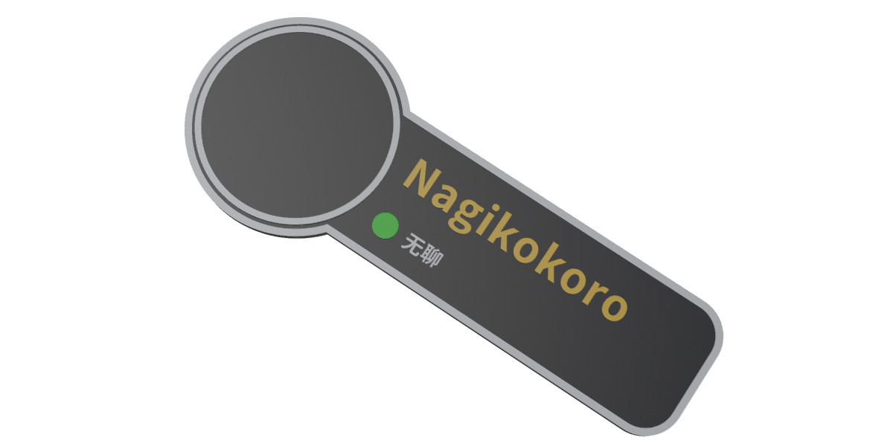
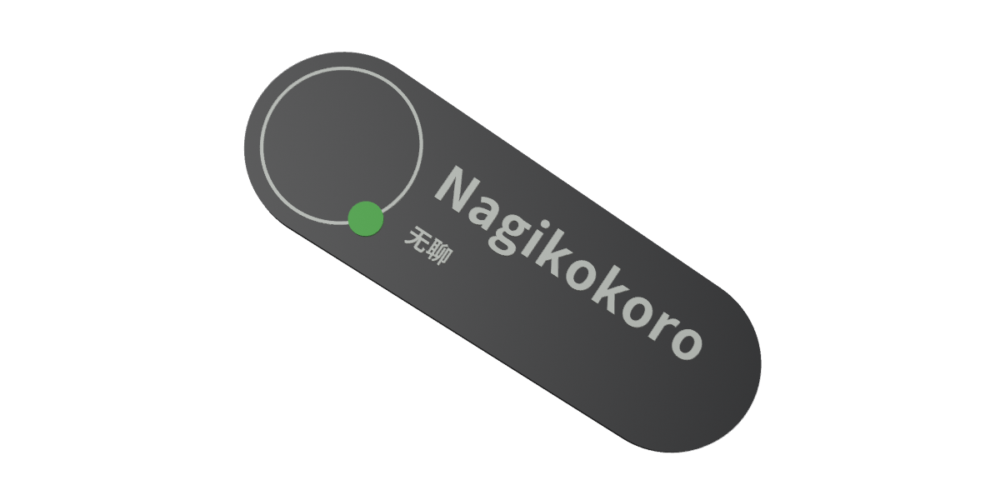
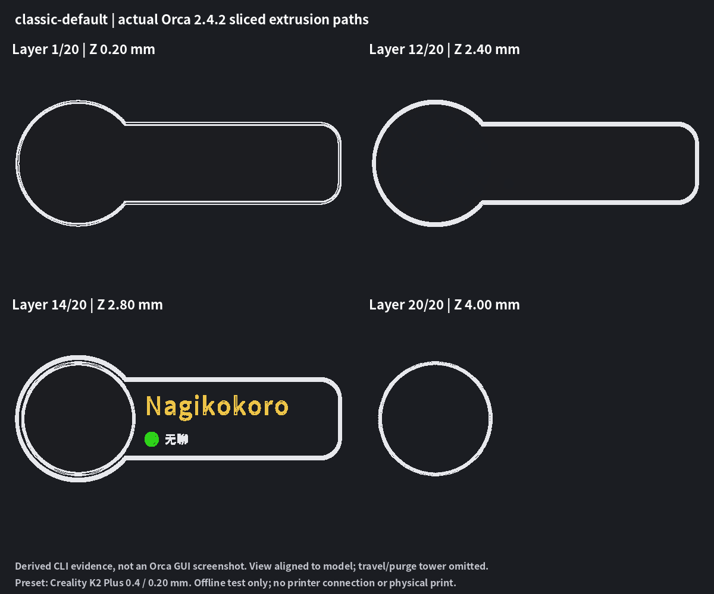
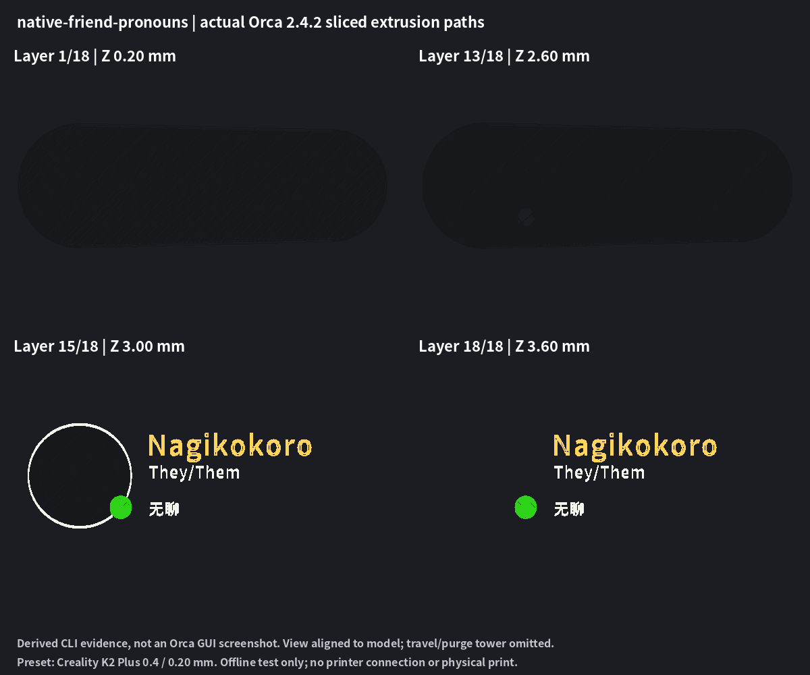

# VRCTag Studio Beta 验收 — 2026-11-04

**结论：CONDITIONAL。** 自动与独立验证通过，已增加真实官方 Blender 扩展导入、官方 lib3mf 严格读取和 OrcaSlicer 实际命令行切片证据；仍不能无条件宣称可公开商业发布或可靠实体打印。阻断无条件批准的事项是：**本轮真实网页 GUI 仍 BLOCKED、Classic 的宽松设计许可未明确、切片器 GUI 逐层复核与本人试打未完成**。没有合并 main、Release、VPS/DNS/生产配置或打印机操作。

分支 `codex/vrc-nameplate-web`，[PR #1](https://github.com/RICHARDwuxiaofei/vrctag/pull/1)。本报告核对的完整代码检查点：`28def62309fdbbdf681ecf6e3775014f2434e888`；代码/模型检查点与最终报告/证据提交分开保存。最终完整测试使用临时输出，避免重写已独立审计的 116 个源包；[最终 Classic 诊断](../studio/evidence/beta-2026-11-04/final-matrix-classic.json)、[最终 Native 诊断](../studio/evidence/beta-2026-11-04/final-matrix-native.json) 记录该完整代码 SHA。报告和数据提交位于该检查点之后；**最终完整交付 SHA、远程同步与干净工作区状态在 PR 最新描述及本轮最终回复**，避免在提交内容内伪造自指 SHA。

## 模型与实际示例

| 文件 | 状态与内容 |
| --- | --- |
| [studio/classic.blend](../studio/classic.blend) | PASS，原件未改，134×52×4 mm，5 个基础实体，大头像白缘/黑底结构 |
| [studio/native.blend](../studio/native.blend) | PASS，原件未改，118×40×3.6 mm，4 个基础实体，近黑胶囊与薄前层 |
| [studio/vrc-tag-original.blend](../studio/vrc-tag-original.blend) | PASS，本机独立 Blender 重新打开；作为初版独立模型保留 |
| [Classic Nagikokoro demo](../studio/demos/classic-nagikokoro.blend) | PASS，从本轮真实默认 3MF 的实际顶点/三角形与装配变换创建，不是替代字体或假文字；含 Name、Status_Text「无聊」、状态点 |
| [Native Nagikokoro demo](../studio/demos/native-nagikokoro.blend) | PASS，同上；实际重开检查有真实文字网格、闭合正体积和来源 SHA 标记 |

正式源单位 0.001 m/BU，坐标为 mm，+Z 正面、+Y 向上、平背 Z=0。文字锚点和节点材质均核对；基础 JSON 与正式源的顶点和三角形逐项一致；GLB 用真实 Three.js 加载器复核分件、尺寸，并实际从重开副本重新导出后确认米/mm 换算。无外部文件缺失，编辑一处顶点再恢复并导出测试副本成功。

所有操作使用**单独后台 Blender 进程**，未调用 MCP 改写当前工作场景，也未关闭用户实例。MCP 仅只读状态检查，协议 9 的兼容接口仍可用。正式三份 `.blend`、根旧模板/Python/ATTRIBUTION 的 SHA 未改变；原根许可证仅按本轮授权改为 MIT，并将之前文本逐字节归档。[保留核对](../studio/evidence/beta-2026-11-04/preserved-source-check.json)。

### 本轮真实渲染

| Classic | Native |
| --- | --- |
|  |  |
|  |  |

这些图来自本轮真实 3MF 生成的 Blender 演示，并显示实际 CFS 配色。没有用历史渲染或旧网页截图替代。**网页实际桌面/390/320 截图未获得，不能把上表当 GUI 证据。**

## Linux 环境与工具来源

- Fedora Linux 44 Workstation、x86_64；Node v24.18.0、npm 11.16.0、宿主 Python 3.14.7、Blender 5.2.1 LTS、Flatpak 1.17.6。原有 Flatpak 应用列表无 OrcaSlicer/切片器。
- 新测试工具全部为普通用户的 `/tmp/vrctag-beta-tools` 隔离副本，**没有 sudo、系统安装、全局插件注册、系统软件源变更或现有应用配置覆盖**。重启后临时副本可能消失，不宣称已永久安装。
- OrcaSlicer 2.4.2：从 [官方 GitHub Release](https://github.com/OrcaSlicer/OrcaSlicer/releases/tag/v2.4.2) 取一个 x86_64 Ubuntu 24.04 AppImage，137,759,224 字节，SHA-256 `d12fb8c8eac1aecd2dfb6377acd48f994f8fa439ed5292fa532dd82880f029fd`，与官方 API digest 一致。解包运行，无 FUSE/管理员需求，XDG/`--datadir` 指向独立临时目录。
- Blender 3MF Import/Export 2.7.8：从 [Blender Extensions 官方页](https://extensions.blender.org/add-ons/threemf-io/) 链接下载，349 KB 左右，SHA-256 `403f2eee3f34926ea78ad67c08d96318102b02a4d82494d4dab283f51f6f2fb9`。在独立进程运行扩展官方 programmatic API（同一导入流水线），未改用户偏好。
- lib3mf 2.5.0：从 [3MF Consortium 官方发布](https://github.com/3MFConsortium/lib3mf/releases/tag/v2.5.0) 取官方 manylinux wheel，1,575,000 字节，SHA-256 `b4c00033c47cfeac93b7daa069fb46e8dea4391d5522b79cd6e9f6af75e33013`；直接解包/PYTHONPATH 调用官方二进制，不改系统 Python。
- Blender 日志有 OCIO 2.5 配置与 2.4.2 库不匹配的警告，使用 fallback 颜色管理；实际节点色/网格数值另外验证，未擅改系统库。所有本轮独立 Blender 流程正常退出，未再发生前轮后台退出挂起。

环境与来源记录在 [environment.json](../studio/evidence/beta-2026-11-04/environment.json)、[Orca provenance](../studio/evidence/beta-2026-11-04/orca-provenance.json) 及同目录 lib3mf/插件 provenance。未找到 Creality Print，本轮不额外下载第二个大型切片器版本。

## 分级验收，互不替代

| 等级 | 状态 | 证据与限制 |
| --- | --- | --- |
| 自有结构/几何验证 | PASS，18/18 Beta 主矩阵 | ZIP CRC/XML、mm、单装配、多网格、逐壳闭合/方向/体积、退化/相交、装配定位、材料实际引用；[独立报告](../studio/evidence/beta-2026-11-04/independent-print-audit.json) |
| 官方 lib3mf 格式读取 | PASS，18/18 | 严格模式，零警告，所有 mesh valid/manifold/oriented、单组件装配、每个部件实际 base-material 颜色与槽位计划一致；[报告](../studio/evidence/beta-2026-11-04/lib3mf-validation.json)。不等于喷嘴/层宽认证 |
| 官方列表 Blender 扩展导入 | PASS，两样式默认例 | 7 个 Classic / 6 个 Native 实际网格，名字/状态均存在，mm 尺寸正确、闭合正体积；每个材质线性色值与源 3MF 对照通过；[报告](../studio/evidence/beta-2026-11-04/blender-extension-import.json) |
| Orca 原始 Core 3MF 导入 | PARTIAL（几何 PASS、自动颜色映射未保留） | 实际 CLI 信息/回存后，一个对象内保留多个独立体积，逐个三角形与归一化顶点对照确认几何未变。Core 名字/材料没有自动变成原耗材分配，初始均默认耗材，不能称自动 CFS 工程兼容 |
| Orca 显式映射后的实际切片 | PASS，18 个主样例 | 真正调用 Orca `--slice 0`，最终生成含 G-code 的项目/result，18/18 返回成功；原部件按源计划映射相同槽位仍保持独立；Classic 默认/好友及 Native 好友使用工具 0/1/2/3，Native 默认用 0/1/3，金色槽 2 合理闲置；全视觉 Classic 为 5 色、Native 为 7 色，软件切片使用相应工具数，不能当作单组四槽 CFS 可直接执行 |
| Orca GUI 导入/逐层截图 | NOT_TESTED | CLI 报 display :0 不可用；没有伪造 GUI 截图或借浏览器策略绕过限制 |
| Creality Print 导入/切片 | NOT_TESTED | 无现成安装；Orca 使用 Creality K2 Plus 预设不等于 Creality Print 软件通过 |
| 实物打印/接合/最小笔画 | NOT_TESTED | 无打印机连接或打印操作，需拥有者实测 |

### 3MF 主矩阵与警告

Classic、Native **分别**生成 9 个样例：默认、Friend＋Pronouns、中文、日文、混排、长名字、自定义状态/自定义点色、四槽自定义映射、全视觉配色，共 18 个，均完成实际 CLI 导入与显式映射后的切片。[逐项配置/结果](../studio/evidence/beta-2026-11-04/matrix.json)、[样例/哈希/细笔画警告](../studio/evidence/beta-2026-11-04/sample-manifest.json)。

- 预览 Design 的每个顶点（按导出 6 位小数量化）及每个三角形与实际 XML 逐项相同；导出不是另造近似模型。
- 检查了每个文字底部与底板真实顶面同 Z 接触；独立检查底部顶点、边中点和三角形重心投影有底板支撑。名字/Pronouns/状态文字与状态点、头像框之间保持分开的通道或水平带。此为接触/密集采样筛查，不是粘合强度或所有曲面的形式证明。
- 自有验证器新增“实际 mesh pindex / printing slot / palette / 部件名一致”“装配每个独立网格只出现一次”“重复 ZIP 成员拒绝”等检查；新增 6 个包级回归覆盖错误映射与重复装配，未修改 F-01 缺陷拒绝预期。
- CFS4 保留 4 个可用槽和所有独立部件，不要求每个配置都用完四槽。全视觉配色允许超过四种材料。多部件共用耗材时，源 XML 引用和实际 Blender/lib3mf 读取均保留各部件；Orca 显式设置后也独立保留。
- 混排/长名字有细笔画或缩放警告：Classic mixed/long 各 1 条、Native mixed 1 条/long 2 条。没有删除警告或把小字当成可打印保证；各自具体毫米估计在 manifest。仍须切片放大/试打。

默认/好友可下载源样例：

- [Classic default](../studio/evidence/beta-2026-11-04/samples/classic-default.3mf) / [Classic Friend＋Pronouns](../studio/evidence/beta-2026-11-04/samples/classic-friend-pronouns.3mf)
- [Native default](../studio/evidence/beta-2026-11-04/samples/native-default.3mf) / [Native Friend＋Pronouns](../studio/evidence/beta-2026-11-04/samples/native-friend-pronouns.3mf)

### 真实切片结果与逐层路径

采用软件自带 **Creality K2 Plus 0.4 nozzle / 0.20mm Standard / Generic PLA** 作为离线测试预设，不是在认定拥有者的实际打印机/耗材。先由 Orca 回存完整项目，几何匹配每个源部件，再显式设置耗材槽/颜色并切片，相当于切片软件中的手工映射。**没有把不完整的厂商元数据注入网页导出器，也没有把手工映射说成自动导入。对 5/7 色全视觉案例，仅为离线软件测试按颜色数扩展预设中已有的名义擦料矩阵（非对角 280 mm³、向量 140 mm³），没有进行实际耗材的擦料校准；单组四槽设备仍须重映射或使用足够耗材槽的已校准设置。**

[18 例切片记录](../studio/evidence/beta-2026-11-04/orca-validation.json)；实际切片工程：[Classic 默认](../studio/evidence/beta-2026-11-04/orca/classic-default-assigned-sliced.3mf)、[Native 默认](../studio/evidence/beta-2026-11-04/orca/native-default-assigned-sliced.3mf)、[Classic 好友](../studio/evidence/beta-2026-11-04/orca/classic-friend-pronouns-assigned-sliced.3mf)、[Native 好友](../studio/evidence/beta-2026-11-04/orca/native-friend-pronouns-assigned-sliced.3mf)。这些含真实 G-code，是验收结果，**不是可直接用于拥有者设备的打印指令承诺**。

图由真实 G-code 生成，支持 G2/G3 圆弧插值、前导小数和实际工具切换；视图逆转了自动排版的旋转以方便阅读，省略旅行/擦料塔/对象外路径，以名义线宽显示中心路径。它们**不是 Orca GUI 截图**，也不证明所有细笔画/层间粘合已达到实物标准。其余两例逐层图同目录，选层依据底板上/下界与最高层，数据见 [layer-plots.json](../studio/evidence/beta-2026-11-04/layer-plots.json)。

## 网页验收与构建

| 项目 | 状态 |
| --- | --- |
| `npm ci` | PASS，锁定 35 包；仅普通用户临时缓存。esbuild install-script 授权提示保留在日志；实际构建成功 |
| `npm run check` | PASS |
| `npm test` | PASS，39/39，含原模型/字体/Worker/配置/导出测试及新许可范围回归 |
| `npm run test:review` | PASS，Classic 43/43、Native 43/43；原反向独立壳继续 reject |
| 额外回归包独立审计 | PASS，98/98，[汇总](../studio/evidence/beta-2026-11-04/regression-audit-summary.json)；与主矩阵 18 个独立审计分开计，共 116 个源 3MF 包 |
| Python 回归 | PASS，网格 6/6，新增包级 6/6 |
| `npm run build` | PASS；保留 bundle >500 KB 提示，不隐藏或调低门槛 |
| 静态包检查 | PASS，103 个按需字体块均存在/大小一致，覆盖不减；未带测试/evidence/旧模板/私密图；新许可文件和两模型均可用 |
| 桌面 / 390px / 320px 最新 GUI | BLOCKED，未取得本轮实际截图 |
| GitHub 许可自动识别 | PARTIAL：远程文件及标准 MIT 正文比对通过，API 仍为 Other/NOASSERTION，未伪报识别成功；[证据](../studio/evidence/beta-2026-11-04/github-license-recognition.json) |
| 本轮浏览器实际头像/下载/JSON/快速切换/竞态 | BLOCKED；离线测试/源码核对不能替代真实 GUI |
| 本地隐私 | PASS（代码审计）；头像仅 FileReader/canvas，不入网络上传/Config/3MF；实际浏览器抓包 NOT_TESTED |

测试日志、39 项测试、双 43 项诊断、恢复记录均在 [本轮 evidence](../studio/evidence/beta-2026-11-04/)。GUI 全项目清单见 [browser-acceptance.json](../studio/evidence/beta-2026-11-04/browser-acceptance.json)。之前浏览器工具已明确安全策略拒绝本地页面，本轮没有换浏览器、底层调试或网页抓取方式绕过；这里如实记录“保留既有拒绝，未获得新 GUI 证据”，不虚报新的操作结果。

静态构建新增检查步骤：保留仓库中原 17,002,248 字节字体作为来源/构建/测试原件，但不再复制进 dist；运行时仍加载完整的 103 块中日英字形，初始 common 约 283 KB。检查字体清单所有文件、许可及模型，拒绝误入的 `.blend/.py/.3mf` 或参考资产；Caddy 只需托管 dist，不需要任何生成后端。保留有意的双样式对照页面/其自有渲染图，不把它们冒充本轮 GUI 截图。

## 修复、许可迁移与限制

- 修补自有 3MF 包校验中材料元数据与实际几何引用未逐项对应、装配可能重复引用部件的盲点；有独立失败回归，正常样例无几何重写。
- 测试输出支持 `VRC_TEST_EVIDENCE_URL`，新结果放 Beta 专属目录，不继续改写历史报告/样例；原历史记录按提交原样保留。
- 手机 CSS 原本隐藏页脚第二行，已修复以显示作者/许可证入口；新 Footer 清楚写非 VRChat 官方。
- 软件 MIT、Native/初版独立模型 CC BY 4.0 已实施；Classic 保留单独 NC-SA 例外，旧第三方/字体/库权利不变。根旧许可逐字节归档，历史授权不追溯撤销。[独立迁移报告](LICENSE_MIGRATION.md)、[精确范围](../LICENSE_SCOPE.md)。
- 没有为了修复模型而修改 Classic/Native 正式源，未回滚 F-01/F-02、Worker、字体或 CFS4。Orca 自动材料映射不兼容仍如实记为 PARTIAL，使用者需手工映射。
- 工具失败及合理恢复记录在 [attempts-and-recovery.json](../studio/evidence/beta-2026-11-04/attempts-and-recovery.json)。包括官方 URL 404 后核实入口、临时不完整厂商元数据崩溃（未进入产品）、CLI 输出路径/XML 编码问题及逐层图圆弧解析修复。没有删除产品失败用例或改 F-01 预期。

## Beta 决策与拥有者下一步

1. **合并 main：CONDITIONAL，不建议无条件合并。** 最新真实 GUI 的两样式、多语/长名字、好友/Pronouns/全部状态、头像损坏恢复、JSON、快速切换/导出中编辑/双击、390/320px 仍需授权环境验收并保存真实截图/下载包。
2. **Beta 公开部署：CONDITIONAL。** 技术上静态包可以托管，但需接受并明确 Classic 仍为 NC-SA/待确认的例外；不能宣传整个仓库统一 MIT/CC BY 或无条件可商用。Classic 设计是否可进一步宽松授权仍需拥有者厘清。此任务没有自动部署。
3. **可靠实体打印：尚不批准。** 本人在实际目标切片器（Creality Print 优先）打开源 3MF，确认尺寸和单个多部件对象，手动映射真实四槽耗材，复核外缘/底板接合、文字底层、点与框接触、细笔画及字体缩放。用实际打印机、喷嘴/层高和耗材试打一件，再检查强度、笔画、颜色边界、尺寸和正面效果；保存机型/切片版本/逐层截图/实物照片。
4. Orca 真切片提供了比上轮更强的证据，但其 K2 Plus 预设不证明拥有者机器适配，也不替代 Creality Print/GUI/实物。CLI 读取、GUI 导入、切片、硬件打印四级仍分别记账。

完成范围之外没有任务后台继续运行的承诺。中断恢复请从本报告、evidence 日志和已提交分支继续；工具临时目录若已清理，可按来源 SHA 重新获取同一版本，不必下载多个版本反复尝试。
