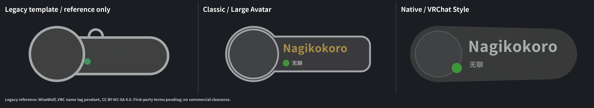
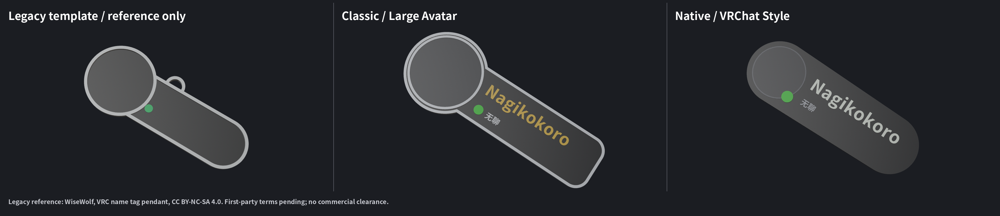
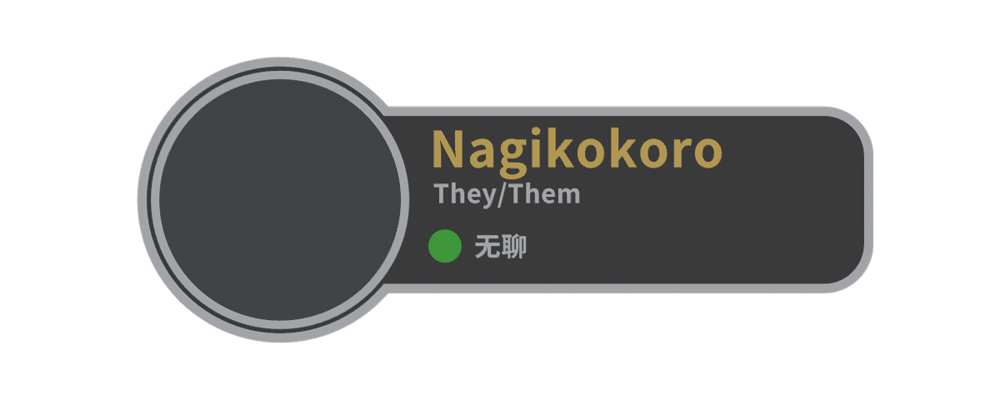
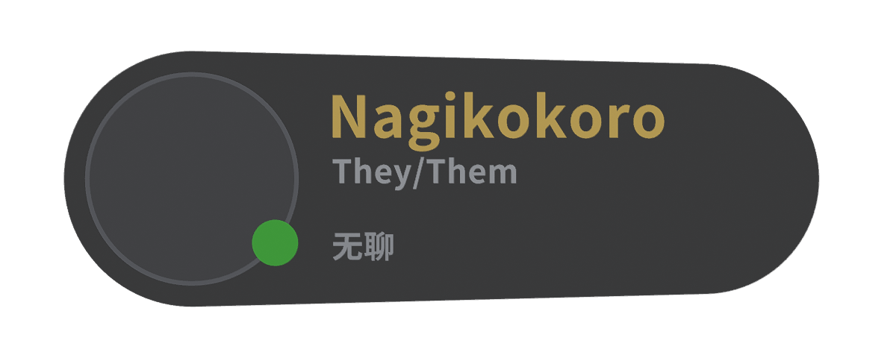

# Classic / Large Avatar 参考纠正与验收

2026-11-03，Asia/Hong_Kong。分支 `codex/vrc-nameplate-web`，代码检查点 `08ec597`、`80c3ef2`。继续更新 [PR #1](https://github.com/RICHARDwuxiaofei/vrctag/pull/1)，保持 Draft，不合并、不发布、不操作 VPS。

**总状态 PARTIAL：可供继续审核；尚未达到正式合并、公开发布或可靠实体打印的验收标准。** 当前三栏证据来自真实 Blender 渲染；当前真实 GUI 验收 BLOCKED，切片器和实物 NOT_TESTED。前轮 Classic 参考对象确实选错，本报告取代前轮把 Classic 定义为网页版第一代小头像胶囊的结论。

## 实际更改

- 单独打开根 `nametag_template.blend`，禁用嵌入脚本，读取旧 Python 生成器布局行为。旧模板只有白缘、黑底和独立状态点；其大头像、黄色名字原由生成器动态添加。模板包含吊环；新 Classic 没有复制吊环或复用旧几何。
- 重新构造 Classic 大头像圆盘与肩部面板，新增独立白色 `Plate_Rim`，不用当前小头像胶囊的简单放大。新轮廓为自选圆弧与圆角矩形肩部的解析组合，文字区域较窄、头像突出上下边缘，右端为短圆角而非 Native 长胶囊。
- 保留 Native 源文件、JSON、GLB、几何、配色与布局字节不变，仅为统一显示高度重新渲染证据图。证据见 [保留文件哈希](../studio/evidence/classic-large-avatar-2026-11-03/preserved-files.json)。根模板、Python、LICENSE、ATTRIBUTION.md 也未改变。
- 样式卡片标识 Classic / Large Avatar 与 Native / VRChat 拟原生。共用编辑器、Worker、Noto 按需字形、逐壳校验、导出与配置恢复。切换继续保留输入、头像和显式耗材设置，下载包含当前样式 ID。
- 状态文字独立 X 区域写入布局元数据，Classic 状态点放在状态行前方。默认 Nagikokoro / 无聊 / Online / 无 Pronouns / 非好友。Classic 默认名字黄色、好友更亮金色；Native 默认白色、好友金色。好友不改变外框。
- CFS4 默认颜色与部件槽位改由样式配置提供：Classic 黑底/头像底、白框/小字、黄或金名字、状态色，仍保留所有独立实体。Name 与白框不会因槽位共用而都变黄。自定义耗材颜色、映射和全视觉配色继续可用。
- 新增真实支撑三角面检查，支持 Classic 凹肩轮廓，替代只适用于凸胶囊的数学检查；逐个文字顶点必须有真实底板支撑。新增状态点与文字水平带/纵向通道间距检查，修复有 Pronouns、无状态文字时的潜在碰撞。
- F-01 逐壳体/空腔/反向壳拒绝、F-02 头像错误隔离、Worker 最新请求/冻结导出、按需字体和 WebGL 资源释放逻辑保留。未引入后端生成或上传请求。

## 视觉与结构对照

左栏是**未烘焙名字/头像的真实旧模板**，不是旧生成器完整输出。原模板颜色缺失处仅在内存中赋中性白以便观察，未保存、未导出为新版网格。三栏采用相同中性显示、1200×480 单栏尺寸，正交横向视野为各自高度的 3.5 倍，统一画面显示高度，**不是统一 mm/像素的尺寸比较**。中间和右侧使用同样默认示例，文字来自实际生成/导出的动态网格。

独立文件：[旧模板透视](../studio/evidence/classic-large-avatar-2026-11-03/reference/legacy-template-perspective.png)、[Classic 透视](../studio/evidence/classic-large-avatar-2026-11-03/classic-default-perspective.png)、[Native 透视](../studio/evidence/classic-large-avatar-2026-11-03/native-default-perspective.png)。

| Classic Friend + Pronouns | Native Friend + Pronouns |
| --- | --- |
|  |  |

网页的 `styles-compare.html` 已更新为当前两个模型的渲染对照，设计器卡片也使用新缩略图。**这些是 Blender 证据，不是浏览器 GUI 截图；没有使用旧网页截图冒充当前效果。** 原模板参考图和包含它的拼版只在仓库 evidence，未加入 web/public 或 dist。

| 参数 | Classic / Large Avatar | Native / VRChat Style |
| --- | --- | --- |
| 总尺寸 | 134×52×4 mm | 118×40×3.6 mm |
| 主要轮廓 | 大圆盘、窄肩部面板、独立白缘 | 左右端半径不同的近黑胶囊 |
| 头像 / 头像框径向厚度 | 44 / 1.5 mm | 32 / 0.7 mm |
| 状态点直径 / 位置 | 6 mm / 状态行前方 | 7.2 mm / 头像旁 |
| 名字 / Pronouns 字高上限 | 10.5 / 4.8 mm | 11.2 / 5.2 mm |
| 名字 / 状态文字可用宽度 | 70 / 62.5 mm | 67 / 67 mm |
| 文字起始 Z / 浮雕厚度 | 2.6 / 0.8 mm | 2.8 / 0.8 mm |
| 基础实体数 | 5 | 4 |

新版主体为中性近黑/深灰，框为中性灰白；未加入绿色主体材质。绿色仅来自状态点。视口/Workbench 灯光会影响亮度，色值与节点色已独立核对。

## 验收结果与证据

| 项目 | 状态 | 证据与边界 |
| --- | --- | --- |
| TypeScript / 生产构建 | PASS | [typecheck](../studio/evidence/classic-large-avatar-2026-11-03/typecheck.txt)、[build](../studio/evidence/classic-large-avatar-2026-11-03/build.txt)；仍有大 bundle 提示 |
| 全部自动测试 | PASS | 37/37，[日志](../studio/evidence/classic-large-avatar-2026-11-03/unit-tests.txt)；含字体、GLB、壳体/空腔、导出、配置、Worker 并发、两样式组合与间距检查 |
| `npm run test:review` | PASS | Classic 43/43、Native 43/43；[Classic](../studio/evidence/classic-large-avatar-2026-11-03/matrix-classic.json)、[Native](../studio/evidence/classic-large-avatar-2026-11-03/matrix-native.json)；保留原反向独立壳的 reject 预期 |
| Python 网格回归 | PASS | 6/6，[日志](../studio/evidence/classic-large-avatar-2026-11-03/python-regressions.txt)；含 F-01、合法空腔、穿插风险 |
| Blender 源重开与检查 | PASS | [报告](../studio/evidence/classic-large-avatar-2026-11-03/blender-checks.json)：Classic 5、Native 4 闭合正体积实体；锚点、单位、节点颜色、实体交叠检查；Native 最大数值残差约 2.5e−7 mm³，小于 1e−5 阈值 |
| 基础几何退化面 | PASS | Classic 导出构造检查为 0 退化面、0 非流形边；首次构造重复角采样产生退化面，已去重修正，没有放宽校验阈值 |
| GLB 加载与实际尺寸 | PASS | 两套真实 GLTFLoader 加载及物理包围盒检查，米/mm 换算正确 |
| 新旧资源隔离 | PASS（构建依赖） | 运行时与模型生成不读取旧 Python/模板，参考仅在独立证据目录；哈希保留证据与来源说明 |
| 组合导出与独立解包网格审计 | PASS（96/96） | 36 个样式组合＋60 个诊断接受样本，共 96 文件；[最终汇总](../studio/evidence/classic-large-avatar-2026-11-03/independent-summary.json)与[最终文件哈希](../studio/evidence/classic-large-avatar-2026-11-03/sample-hashes.json)。独立 Python 检查 OPC、CRC、XML、单装配、多部件、mm/尺寸、材料、逐壳方向/封闭/体积/相交 |
| 预览/导出使用同一网格 | PASS（代码与离线测试） | 渲染演示文字由 export 同源 Design 数据生成；序列化后量化网格再校验。当前 GUI/实际下载一致性仍待浏览器验收 |
| F-02 损坏头像真实 GUI 回归 | BLOCKED | 继续保留头像独立错误状态；当前无法获得真实浏览器操作证据，不能套用初版历史 PASS |
| 桌面 / 移动 GUI、真实切换/下载/上传 | BLOCKED | 前轮浏览器工具明确安全策略拒绝访问目标；未改用其他浏览器、原始调试接口或模拟截图绕过。当前无最新 GUI 截图，手工验收步骤见下 |
| 隐私 | PASS（代码审计） | 上传只走 FileReader/本地 canvas；头像不进 Config、Design、3MF 或网络上传。未做本轮真实网络抓包 |
| 最新文件官方 XSD / lib3mf | NOT_TESTED | 独立自有检查不等于完整规范实现认证，也不套用旧批次结果 |
| Creality Print / OrcaSlicer 导入与切片 | NOT_TESTED | 当前未发现可用安装，不擅自安装大型软件；没有机器/层预览证据 |
| 实物、材料接合、最细笔画 | NOT_TESTED | 仅拓扑/体积/采样细笔画筛查，不能保证 0.4 mm 喷嘴保留所有中日文字形或层间粘合 |

诊断中 Classic 非好友预期从初版白色改为本次设计要求的固定 `#edc448`，Native 仍预期白色；这是外观需求变更，F-01 的拒绝预期和缺陷用例完全保留。第一轮未同步该颜色预期的 38/43 结果保存在 [interim](../studio/evidence/classic-large-avatar-2026-11-03/interim/matrix-before-color-contract-update.json)，未删除失败项来掩盖结果。最终两个 43 项均通过。

## 交付文件

- 源：[Classic](../studio/classic.blend)、[Native](../studio/native.blend)；[布局/几何注册表](../web/src/styles.catalog.json)。
- 网页：[运行说明](../web/README.md)，`npm --prefix web run dev`；静态构建 `npm --prefix web run build`；[部署说明](STATIC_DEPLOY.md)。本次没有上线或修改服务器。
- 样例：[Classic 默认](../studio/evidence/classic-large-avatar-2026-11-03/classic-default.3mf)、[Classic Friend + Pronouns](https://github.com/RICHARDwuxiaofei/vrctag/blob/106f547440b011836195460338c99deb3a2163e6/studio/evidence/classic-large-avatar-2026-11-03/classic-friend-pronouns.3mf)、[Native 默认](https://github.com/RICHARDwuxiaofei/vrctag/blob/106f547440b011836195460338c99deb3a2163e6/studio/evidence/classic-large-avatar-2026-11-03/native-default.3mf)、[Native Friend + Pronouns](https://github.com/RICHARDwuxiaofei/vrctag/blob/106f547440b011836195460338c99deb3a2163e6/studio/evidence/classic-large-avatar-2026-11-03/native-friend-pronouns.3mf)。其余中/日/混排/长名字/状态样例同目录。
- 参考署名：[reference/NOTICE.md](../studio/evidence/classic-large-avatar-2026-11-03/reference/NOTICE.md)，原作 WiseWolf，CC BY-NC-SA 4.0。根 LICENSE 不变。

## 剩余验收与风险

在能用的真实浏览器分别检查 1440px 桌面和 390/320px 窄屏：多次切换两个卡片，同时输入文字，等待最后预览后立即下载；解包 `Metadata/design.json` 检查 styleId、名字和尺寸。导出中继续编辑、双击下载、重置和恢复 JSON；损坏头像后仍应能导出，有效头像重新上传/移除后恢复，切换仍保留头像。实际打印配色中照片和人物占位应隐藏；头像前后文件不应包含图片。保存真实 GUI 截图与下载包后才能改 PASS。

在 Creality Print 优先分别导入上面四个样例，核对 134×52×4 和 118×40×3.6 mm，各自一个多部件对象。手工把独立部件映射四个实际耗材，确认白缘/白字、名字黄/金和点色分别正确；文件是通用 Core 3MF，不含 Creality 专有工程/CFS 自动绑定或打印机温度参数。逐层查看文字底部与底板接合、白缘侧接、头像顶层、Native 薄前层和细小中文字笔画，确认无空层/丢笔画/悬空，再试打；重复 OrcaSlicer 并记录软件版本、喷嘴、层高和截图。未验证前不得标记“可可靠打印”。

Classic 没有复用旧网格，但明显参考旧作整体设计。独立几何实现并不自动排除衍生设计许可义务，不能据此声称已获得独占权利或可商业部署。应先由拥有者厘清新 Classic 的许可范围；本任务不重新选择根许可或新作品最终许可。Native 之前的视觉与打印风险也继续保留。
