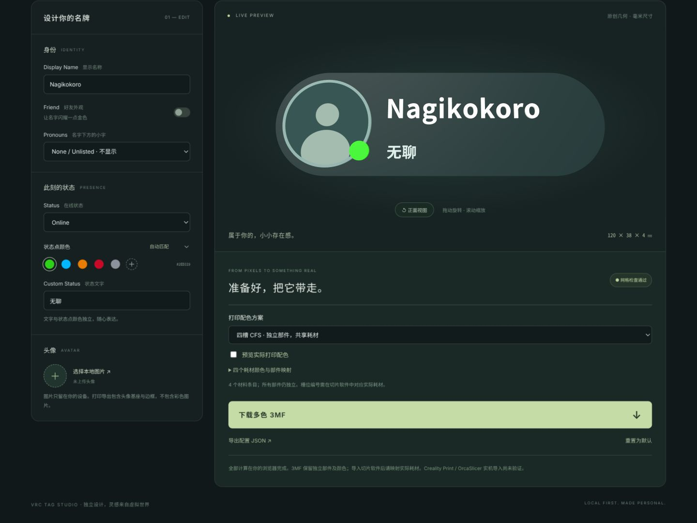
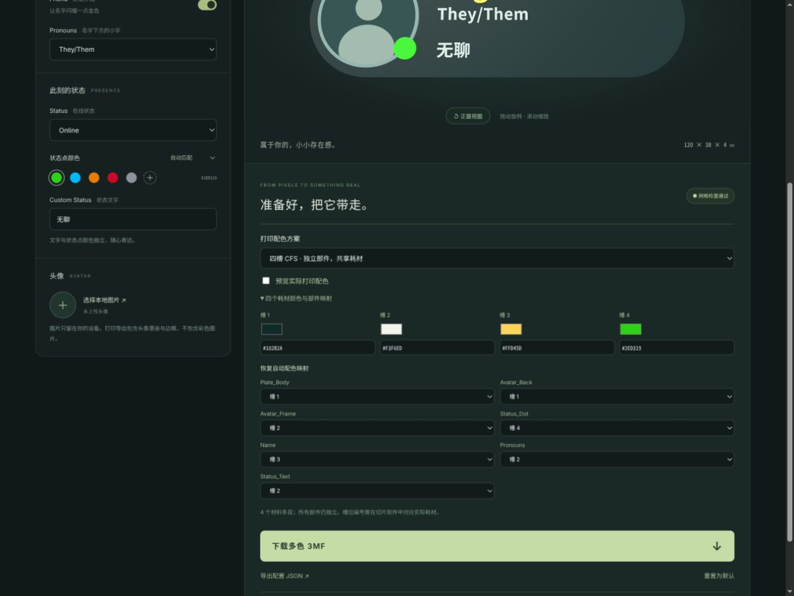
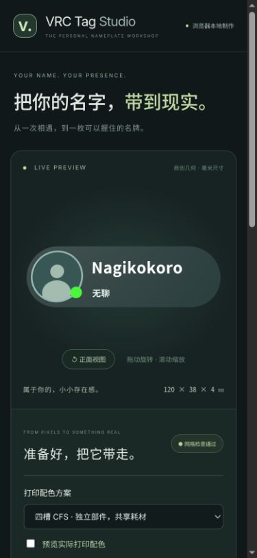

# PR #1 修复与重新验收报告

日期：2026-11-03，Asia/Hong_Kong。分支 `codex/vrc-nameplate-web`；审核基线 `1f7a159`；最终代码检查点 `974e13c`（后续提交仅更新证据/文档）。[PR #1](https://github.com/RICHARDwuxiaofei/vrctag/pull/1) 保持 Draft，不自动合并、发布或部署。

**总体：PARTIAL。** 已确认的 F-01、F-02 修复并有回归证据；静态网页和本地导出可供继续审核。不能宣布已满足可靠实体打印、正式公开发布的全部标准。Creality Print、OrcaSlicer 和打印硬件均未可用，尚需真实切片/试打；第一方最终许可仍由拥有者决定。

## 本次实际修复

- **F-01 PASS**：TS 与独立 Python 校验器现在划分连通三角形壳，检查有限坐标、退化面、双向闭合边、顶点邻域、逐壳有向体积和相交。按实体包含深度判定外壳/空腔/空腔内实体的方向：孤立反向外壳拒绝，合法负方向内腔允许，错误空腔方向拒绝。检测包含共面重叠的三角形交叉（含共享边折叠风险）。导出前另校验实际写入的六位小数坐标。原复现用例 `mesh-disconnected-inward-shell` 预期仍是 reject，现 PASS；历史 FAIL 证据原样保留在 11-02 目录。
- **F-02 PASS**：头像、模型、导出错误分离。真实浏览器上传损坏图片后仍成功下载 3MF；重新选择有效图片、删除和重置可恢复。上传前后实际下载的每个 ZIP 条目逐字节一致，证明图片未混入打印数据。
- Worker 合并待处理的建模请求，立即更新配置版本并丢弃过期结果；失败字体请求可重试；重建 Worker 后忽略旧实例消息。导出捕获独立配置快照，以同步锁阻止双击重复提交；重置失效旧响应。补测发现同值编辑/重复默认重置会使旧请求失效而不触发新请求，现改为按配置对象更新触发，避免永久计算中；真实浏览器已补测坏头像→默认重置、连续两次默认重置和重复同值颜色，全部恢复可导出。资源失败模拟中，缺失字体会阻止导出，补回静态资源后通过界面重试恢复。
- 预览使用同一打印网格；可切换实际打印配色。几何、材质、贴图、渲染器和控制器均有释放。47 次配置变化的有限回归中，GPU 计数从 8 geometry / 1 texture 到 7 / 1，没有累积；这不代表数小时或实际手机耐久验收。

## Blender 原创模型与布局

通过现有 Blender MCP 修改本项目原创源，无旧模板导入。基础 GLB、JSON、锚点与浏览器布局同步。

| 尺寸 | 修改前 | 修改后 |
| --- | --- | --- |
| 胶囊主体 | 120 × 38 × 3 mm | 保持，整体最大厚度 4 mm |
| 头像显示基座直径 | 24 mm | 30 mm |
| 头像框径向厚度 | 2 mm | 1 mm（外径 32 mm） |
| 状态点直径 | 5 mm | 7 mm |
| Pronouns 最大字形高度 | 3.7 mm | 5.2 mm，长文本等比缩小 |
| 主名字高度 | 10 / 8 mm | 无 Pronouns 10 / 有 Pronouns 9 mm |
| 文字可用宽度 | 72 mm | 69 mm，左边界 X=-19 mm |

头像与状态点相邻处切出同圆凹口，避免实体交叠。Blender 成对布尔交体积检查：除浮点残差外为零，最大约 7.6e-7 mm³（判定阈值 1e-5 mm³）。所有浮雕接合于底板 Z=3 mm；名字、Pronouns 和状态文字分配不同水平带；无 Pronouns 或状态文字时按布局规则重排。好友仅改变名字，不添加说话金边。动态名字不烘焙进源文件。

| 修改前 | 修改后 |
| --- | --- |
|  |  |

另有 [侧面](../studio/evidence/fixes-2026-11-03/model-side.png)、[透视](../studio/evidence/fixes-2026-11-03/model-perspective.png)、[可编辑源](../studio/vrc-tag-original.blend)。MCP 实际重开源文件，四个实体 0 非流形边、体积为正；[重开日志](../studio/evidence/fixes-2026-11-03/blender-reopened.json)。

## 四槽配色与打印数据

默认 CFS4 将视觉颜色映射到四个材料槽：深色底板/头像底座，浅色文字/框/小字，金色好友名字，状态点。允许自定义四槽 HEX 颜色和逐部件映射，允许多个独立部件共用耗材。仍保留“全部视觉颜色”模式（默认常见配置有 6 色），超过四条目时明确提示。不会为减少耗材合并网格。

3MF 使用 Core 基材颜色、mm 单位、独立网格资源和一个装配 build item；平移后世界尺寸 120 × 38 × 4 mm。`Metadata/printing.json` 保存槽色、映射和需要切片器分配耗材的标记。**四槽映射是文件中的通用材料分组，并非已验证的 Creality 专有工程/自动 CFS 绑定。** 切片器是否完整保留颜色及部件必须实际导入核对。

- [默认四槽样例](../studio/evidence/nagikokoro.3mf)
- [真实浏览器四槽、自定义颜色、Pronouns 样例](../studio/evidence/fixes-2026-11-03/browser-cfs4.3mf)
- [真实浏览器全部视觉颜色样例](../studio/evidence/fixes-2026-11-03/browser-visual.3mf)
- [35 份独立结构/网格检查](../studio/evidence/fixes-2026-11-03/independent-3mf.json)

扫描字形矢量截线估算细笔画风险，小于约 0.4 mm 给警告；过小、不支持字符或无效网格阻止导出。该扫描是启发式，不是严格最小壁厚证明；不替代喷嘴/层高与逐层切片检查。坐标公差、复杂轮廓数值稳定性及有限交叉检查预算仍是边界；超预算按失败处理，不提示成功。

## 测试与证据

| 验收项 | 状态 | 结果与范围 |
| --- | --- | --- |
| TypeScript | PASS | [typecheck.txt](../studio/evidence/fixes-2026-11-03/typecheck.txt) |
| 生产构建 | PASS | [build.txt](../studio/evidence/fixes-2026-11-03/build.txt)，有前端 bundle >500KB 提示 |
| 全部单元测试 | PASS | 23/23，[unit-tests.txt](../studio/evidence/fixes-2026-11-03/unit-tests.txt)，含 GLB 实际加载/尺度 |
| 原有诊断 test:review | PASS | 43/43，保留预期与失败用例，[matrix.json](../studio/evidence/fixes-2026-11-03/matrix.json) |
| Python 壳体回归 | PASS | 6/6，[python-regressions.txt](../studio/evidence/fixes-2026-11-03/python-regressions.txt) |
| 独立解包及检查 | PASS | 35/35，ZIP CRC/XML、mm、引用、材料、装配变换、闭合/方向/壳体/相交/世界尺寸 |
| 受限等效 XSD 模型 XML 审计 | PASS | 35/35，[xsd-validation.json](../studio/evidence/fixes-2026-11-03/xsd-validation.json)，范围见下文 |
| 原样官方 XSD 编译 | BLOCKED | 本机 lxml 拒绝官方 INT_MAX maxOccurs，Java 达到编译节点保护限制；保留原始错误日志，不称正式认证 |
| Blender 重开、网格与尺寸 | PASS | 4 实体，单位 0.001 m/BU，实体坐标 mm |
| 便携路径及生成产物 | PASS | 从 /tmp 指定独立 root 可生成相同网格/元数据，无硬编码用户路径 |
| Blender CLI 干净退出 | PARTIAL | 后台实例生成后未自行退出，有限尝试后终止仅本次实例；原因未证实，实时 Blender 未终止；[portability.json](../studio/evidence/fixes-2026-11-03/portability.json) |
| 新旧隔离及历史版权 | PASS | [legacy-isolation.json](../studio/evidence/fixes-2026-11-03/legacy-isolation.json)，旧 Python/模板/根声明字节不变 |
| 真浏览器回归 | PASS | [browser-tests.json](../studio/evidence/fixes-2026-11-03/browser-tests.json)、[下载复核](../studio/evidence/fixes-2026-11-03/browser-download-checks.json) |
| 桌面/手机视口 | PASS | 1440×1080、390×844、320×740，含展开耗材映射，无横向溢出；手机预览在编辑区上方 |
| 本地头像隐私 | PASS（代码/文件证据） | 图片 data URI，未进入请求或 3MF；未做系统级抓包 |
| 故障恢复/静态子路径 | PASS | /studio/ 临时静态站缺字体→报错禁导出→恢复资源→重试成功 |
| Creality Print 导入及切片 | NOT_TESTED | 未发现可用软件，无擅自安装 |
| OrcaSlicer 导入及切片 | NOT_TESTED | 同上 |
| 实物强度/粘合/细笔画 | NOT_TESTED | 无实际打印 |
| 实体手机、多小时使用 | NOT_TESTED | 本次只有桌面浏览器窄视口和有限压力回归 |
| 生产部署 | NOT_TESTED | 有意不操作 VPS/DNS/生产站点 |

真实浏览器覆盖坏头像后下载、有效头像恢复/删除、好友+自定义 Pronouns+独立状态色、HEX 耗材色/部件共享、视觉多色警告、双击一次下载、点击后立即改名的快照导出、快速连续 35 次配置最后值、再 12 次重建资源计数。快照测试证实下载 A、网页最终 B；不是人为控制调度的所有并发交错证明。

XSD 来自官方 Core 规范附录 B.1.1（blob 与散列在结果文件）。原样编译受现有工具限制。另一次审计只将 INT_MAX 重复上限在内存中改为 unbounded，同时独立强制模型总节点 <1,000,000，比原 2,147,483,647 上限严格；其余约束不变，禁用网络/DTD。只覆盖模型 XML，不是完整 OPC/lib3mf 认证，更不是切片器证明。未放宽网格或原测试预期。

首次最终诊断因受限 Node 子进程调用 Git 返回 EPERM，中断在写报告元信息处；改为可选 SOURCE_COMMIT 环境变量后完整复跑通过，产品逻辑及测试预期不变。截图接口偶发失败，随后成功抓取实际截图。

## 字体与工程

原 17,002,248 字节 Noto OTF 作为来源保留。派生字体按 OFL 重命名 VRCStudioSubset，保留版权和 OFL。构建脚本覆盖原 cmap 的全部 44,810 个支持码点，不通过常见字白名单牺牲中日文覆盖；默认 common 282,924 字节（约 283KB），103 个分块共 13,378,420 字节，其余按需同源加载。默认字体负载减少约 98.3%，不是整个页面体积减少 98.3%。浏览器有界缓存 common + 最多 8 个非常用分块，失败请求可重试；HTTP 使用条件重验证。原完整 OTF 仍会复制到 dist，占部署空间，但默认运行不请求它。JS 主包仍约 737KB，未声称完成极致加载优化。

建模脚本从自身位置推导项目 root，可 `--root` 覆盖；只清理本项目原创集合。CLI 模式重置当前后台场景，不能用来清空用户正在编辑的其他文件。网页依然纯静态，无账号、数据库、上传或生成 API。新版第一方许可仍待决定；[来源边界](SOURCES.md)、[静态部署](STATIC_DEPLOY.md)。

## 后续真实切片验收（必须实际执行才能改状态）

1. 记录软件版本、打印机、喷嘴、层高与四种实际耗材。分别在 Creality Print / OrcaSlicer 打开上述默认和浏览器样例。
2. 确认一个装配对象、6 或 7 个部件、120×38×4 mm、底面 Z=0，无自动修复警告、缺字或移位。若被拆成多个独立对象或颜色丢失，记录为兼容缺陷，不直接标通过。
3. 将四个材料条目映射真实 CFS 槽。核对共享耗材不合并部件，自定义色正确；同时验证视觉六色模式的手工映射行为。
4. 切片后逐层检查 Z=3 mm 接合、所有字形笔画、孔洞、边框与状态点凹口；默认/中文/日文/混合/长名与自定义 Pronouns 都要查看。保留警告及实际切片截图。
5. 先试打默认样例，检查粘合、最细笔画、强度与颜色，记录失败和调整。未完成前，不建议将本 PR 作为“打印已验证正式版”合并或公开承诺可靠打印。

检查点：`faf6b44` 壳体修复；`5e112d6` 比例/四槽/字体/错误隔离；`704b2aa` 最终防护；`0ced025` 诊断便携修正；`974e13c` 同值编辑/重复重置修复。完整推送与证据提交 SHA 见 Git 历史与 PR。
