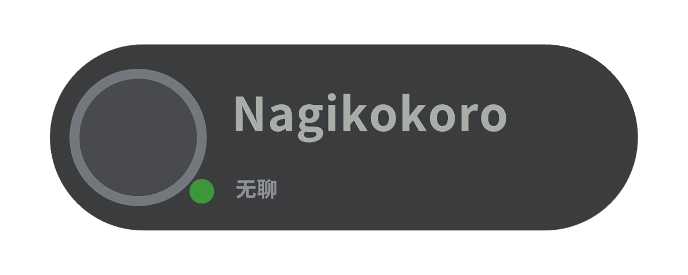
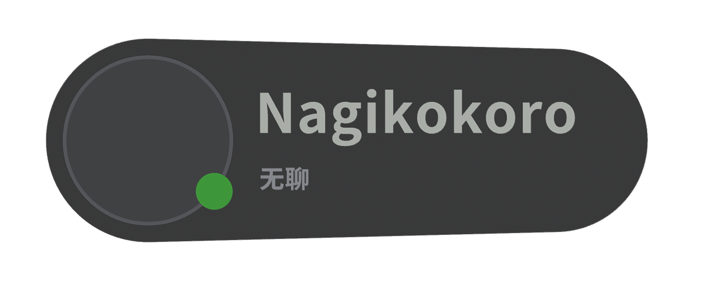
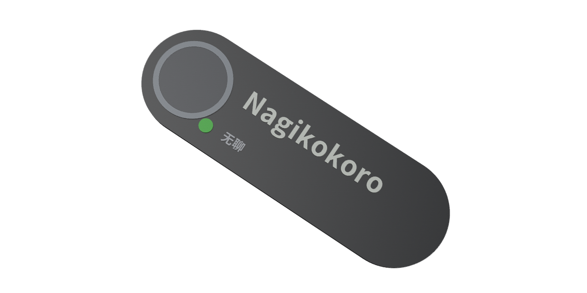
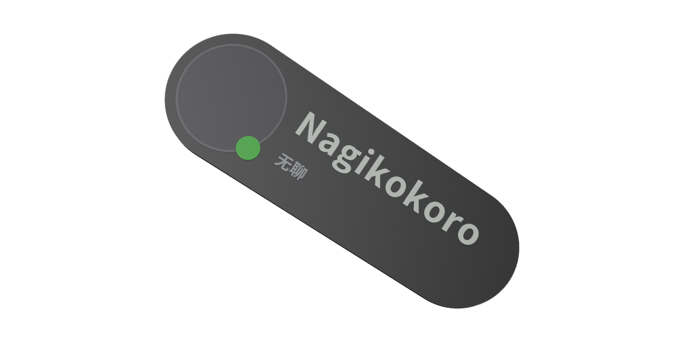
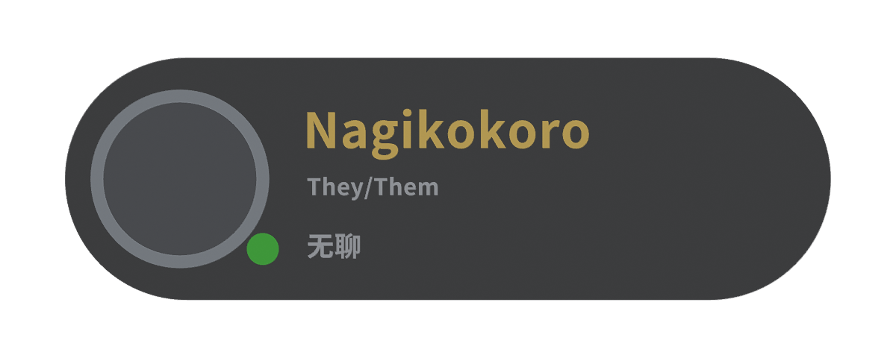
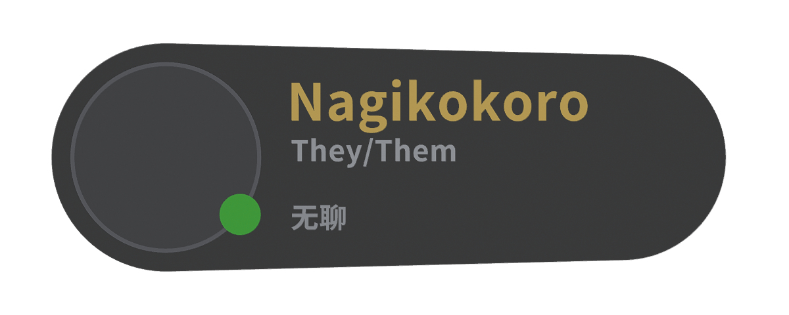

# Classic / Native 双样式交付与验收

> 历史报告：本轮把 Classic 参考对象误判为网页版第一代模型。现已由 [大头像 Classic 重建报告](CLASSIC-LARGE-AVATAR-2026-11-03.md) 取代；本页尺寸、来源与图片只描述当时检查点。

2026-11-03，Asia/Hong_Kong。分支 `codex/vrc-nameplate-web`。本轮基线 `bb8b6d6`，架构/模型检查点 `4e518da`，布局/恢复回归检查点 `7c0113c`，预览修正检查点 `fd0c30b`，同步版本门槛检查点 `896f074`，最终 Native 双行校准检查点 `698318a`。PR #1 保持 Draft；不合并 main、不创建 Release、不部署生产。

**交付状态 PARTIAL。** 两套原创源、网页选择、共同生成/导出引擎、配置恢复及样例已实现。自动检查通过，但本轮真实浏览器访问被工具安全策略拒绝，不能声称新 GUI 已完成桌面/移动验收，也没有制作虚假的网页截图。Creality Print / OrcaSlicer 和实物打印仍 NOT_TESTED。

## 两种实际不同的几何

| 项目 | Classic · 经典胶囊 | Native · VRChat 拟原生 |
| --- | --- | --- |
| 来源 | 恢复 `1f7a159` 网页版原创模型生成逻辑 | 根据对话原生参考，重新独立构造参数化轮廓 |
| 整体尺寸 | 120 × 38 × 4 mm | 118 × 40 × 3.6 mm |
| 主体轮廓 | 两端等半径 19 mm 的对称胶囊 | 左端半径 20、右端 18 mm，以平滑公切线连接；头像侧更饱满 |
| 宽高比 | 3.158 | 2.95，更接近参考约 3:1 |
| 头像直径 | 24 mm | 32 mm，牌高的 80% |
| 头像框径向宽度 | 2 mm | 0.7 mm |
| 状态点直径 | 5 mm | 7.2 mm |
| 默认主名字高度上限 | 10 mm | 11.2 mm |
| 有 Pronouns 时名字高度上限 | 8 mm | 9.4 mm |
| Pronouns 高度上限 | 3.7 mm | 5.2 mm |
| 状态文字高度上限 | 4 mm | 4.6 mm |
| 文字左边界 / 可用宽 | −22 / 72 mm | −18 / 67 mm |
| 背面厚度 / 正面细节 | 底板 3 mm，浮雕 0.8–1 mm | 底板 2.8 mm，头像基座 0.3 / 框 0.35 / 文字与点 0.8 mm |
| 默认底板 sRGB | `#24262A` 中性石墨灰 | `#17181C` 近黑灰 |

两者不是换色皮肤：底板轮廓、尺寸、头像与点的几何、接合、框厚、浮雕厚度、文字锚点和缩放布局均不同。Classic 的四个部件顶点/三角形与 `1f7a159` 原创基础 JSON **逐项一致**；精修集中在中性材质、当前校验/导出引擎与样式架构。[历史恢复证据](../studio/evidence/dual-style-2026-11-03/classic-history-recovery.json)。未导入、恢复或修改 WiseWolf 的 `nametag_template.blend`。

Native 头像与状态点相邻处有匹配凹口，避免实体相占。两套浮雕从各自底板正面开始，背面 Z=0，文字不烘焙到基础源。Native 双行时名字中心 Y=4.5、小字/状态中心 Y=−7.5 mm；三行时使用另一组规则，Classic 保留原布局。名字、Pronouns、状态分配独立水平带，无空行时重排。好友只改变名字为金色，没有说话金边。

## 正面、透视与 Friend + Pronouns 对照

两套默认均为 Nagikokoro / Online / 无聊 / 非好友 / 无 Pronouns / 未上传头像。下图为 **Blender 真实渲染**，不是网页截图。文字来自共用网页引擎生成的同一几何，渲染时按导出精度取六位小数；仅临时加入演示集合，未保存进基础 `.blend`。头像图案仍属于网页预览层，Blender 图显示实体头像基座。

| Classic | Native |
| --- | --- |
|  |  |
|  |  |
|  |  |

提供静态对照页面 `web/public/styles-compare.html`，构建后为 `web/dist/styles-compare.html`，编辑器样式区域也有入口。页面使用上述实拍渲染，列出不同轮廓/尺寸，并可在本机载入参考截图作并排对照，不上传图片。

### 原生参考校准范围

对话里带说话金边的参考截图，本地 `/tmp` 原文件在本轮已不存在，未另行上传或公开打包他人的截图。依据对话可见图做手工近似比例：主体约 3:1、头像约牌高 80%、状态点约 18–20%、主名字约 28%、第二行小字约 13%，双行中心距约牌高 30%。Native 对应 2.95:1 / 80% / 18% / 28% / 13%，默认两行中心距 30%；轮廓宽高比相差约 1.7%。[校准记录](../studio/evidence/dual-style-2026-11-03/reference-calibration.json)。

这是可追溯的手工近似，而非程序像素测量或一比一复刻；透明游戏背景不进入模型。截图的金色外圈属于说话提示，未采用。完整原图逐像素并排验收为 PARTIAL，可在对照页面本地选择原图继续核对。

## 为什么之前偏绿，怎样修改

之前并非仅界面造成错觉：网页底板为 `#102B2A`，Blender 用 `(0.018, 0.038, 0.038)` 线性颜色，头像/边框也偏青绿；网页另有绿色辅助光和绿色预览渐变。现在两套模型共用样式配置的 HEX 材质，Blender 明确将 sRGB 转线性，实际材质节点与配置逐项核对；网页辅助光改为白色，模型画布为中性 `#202126`。UI 的少量绿色强调色保留，Online 点仍按功能为绿色。

Blender 的 Studio 光和网页 PBR 光仍会改变明暗，打印实际颜色需由耗材决定；本次修正的是模型与预览的偏绿色源头，不把屏幕颜色等同实际耗材色。[材质与源检查](../studio/evidence/dual-style-2026-11-03/blender-acceptance.json)。

## 可扩展架构

单一入口为 `web/src/styles.catalog.json`。每个注册项包含 ID、展示文案、缩略图路径、基础网格路径、底板几何参数、布局/锚点、字高规则和材质。ID 是普通字符串，通过注册表查找，不把两种样式编码为布尔开关。

| 文件 | 职责 |
| --- | --- |
| `web/src/styles.ts` | 注册表查询、默认样式、未知 ID 拒绝 |
| `studio/scripts/model_geometry.py` | 同一解析建模器读取样式参数，生成四个原创实体及锚点 |
| `studio/classic.blend`、`native.blend` | 两套独立可编辑源，均实际重开确认 |
| `web/public/assets/styles/<id>/base.json`、`base.glb` | 各自的 mm 网格/元数据与米单位预览 GLB |
| `web/src/model.ts` | 同一字体轮廓/布局/逐壳校验引擎，不含 Classic/Native 分支 |
| `web/src/engine.ts` | 共用异步调度、快照、过期建模请求合并和错误恢复，可独立测试 |
| `web/src/studio.worker.ts` | 同源按样式缓存基础网格、按需字体、转发响应；无后端 |
| `web/src/materials.ts`、`export.ts` | 共同四槽/全视觉色映射、独立部件装配、量化后再次校验 |
| `web/src/config.ts` | JSON schemaVersion 2、样式迁移、输入校验和恢复 |
| `studio/scripts/build_comparison.mjs` | 根据注册表生成对照页面及图片引用 |

两张带真实基础模型缩略图的卡片共用同一编辑器。切换只更新 `styleId`，名字、Pronouns、状态、自定义颜色、好友及本地头像保留。自动材质随样式切换，手工耗材色/槽映射保留。尺寸提示按样式更新；相机按实际尺寸适配。“预览实际打印配色”会隐藏不会打印的头像照片及占位人物图案，只显示实体基座/边框。此修正通过代码与构建检查，真实 GUI 仍待验收。导出还检查同步保存的成功模型版本，避免 React 界面提交前旧配置被误用。待新模型完成且配置键相符后才能导出，旧模型不能冒充新样式。导出文件名含样式 ID，3MF 元数据也记录 ID。

JSON 导出版本为 2，包含样式 ID；“恢复配置 JSON”校验后恢复字段和 Pronouns 选项。旧配置没有样式 ID 时迁移到 Classic；未知 ID/版本、非法字段拒绝，保留当前有效设计。JSON 不含头像，恢复时保留现有本地头像。重置恢复 Classic 和默认个人资料并清空头像。后续编辑/重置会使尚未读完的配置导入失效，避免旧文件覆盖新操作。

新增第三/第四种样式：增加唯一注册项及几何参数 → 用通用 Blender 入口生成源/JSON/GLB → 运行测试获得同一引擎的演示文字 → 生成缩略图/对照图 → 构建。卡片、模型缓存、配置 ID、材质与导出均由注册表驱动，通常无需改编辑器、Worker 或导出器。若新造型超出当前两端圆弧/公切线几何族，可提供自有基础网格生成器；网页仍沿用同一 `Base` 协议与引擎。

根 `base.json` / `base.glb` 暂保留为默认 Classic 的兼容别名，运行时按样式路径读取。历史 `studio/vrc-tag-original.blend` 原样保留，不是这次双样式源入口。

## 自动验收与限制

| 检查 | 结果 | 证据/范围 |
| --- | --- | --- |
| TypeScript / 生产构建 | PASS | typecheck.txt、build.txt；主包约 743KB，有体积提示 |
| 全部单元测试 | PASS | 36/36，原有 23 项保留；新增双样式/配置/引擎队列测试 |
| 原有 test:review | PASS | 43/43，保留用例及预期；F-01 孤立反向壳仍按 reject 检查 |
| 独立 Python 回归 | PASS | 6/6，合法空腔、错向、相交等原测试保留 |
| 多语种和长文本 | PASS（引擎） | 两种样式均含中文、日文、混排、长英文、空行/自定义 Pronouns、全部状态×好友组合 |
| 文字布局 | PASS（样例） | 字形每个顶点在真实凸底板投影内、不同文字水平带不相交，接合 Z 正确 |
| GLB | PASS | 两套均经 Three GLTFLoader 实际解析，部件与物理米尺寸正确 |
| Blender 源重新打开 | PASS | 各 4 网格 + 3 锚点，无默认名字网格；闭合、正体积、材质校验 |
| 基础部件体积交叠 | PASS（1e-5 mm³ 阈值） | Classic 全部为零；Native 最大约 2.5e-7 mm³ 浮点残差 |
| 独立 3MF 检查 | PASS | 66/66，ZIP/XML、mm、材料、引用、装配、尺寸、逐壳方向/封闭/交叉；independent-3mf.json |
| 四槽打印映射 | PASS（文件/引擎） | 四材料条目，默认 6 部件 / 有 Pronouns 7 部件，不合并网格；自定义色及共享槽保留 |
| 并发与恢复 | PASS（Node 引擎） | 连续 20 次样式/文字更新只返回最终值；导出 A 后输入 B 保持 A 的文件与 B 的预览；同值重建、多次导出、资源失败重试 |
| JSON 恢复/迁移 | PASS（纯函数） | 两样式完整 roundtrip，旧配置默认 Classic，未知样式/版本/非法颜色拒绝 |
| 本轮桌面/移动网页实际截图和操作 | **BLOCKED / NOT_TESTED** | 浏览器控制访问本机 HTTP URL 被安全策略拒绝；未换工具/浏览器绕过 |
| 本轮头像实际上传及 GUI 导出回归 | **NOT_TESTED** | F-02 错误隔离和本地头像路径保留；历史实测不冒充新样式实测 |
| 本轮官方 XSD / lib3mf | NOT_TESTED | 以前有限等效审计仅是历史结果，不套用到本轮文件 |
| Blender CLI 干净退出 | NOT_TESTED | 本轮使用 MCP；此前后台退出问题仍保留，不宣称修复 |
| Creality Print / OrcaSlicer 导入及切片 | **NOT_TESTED** | 未发现可用程序/应用；未安装大软件 |
| 实物打印、真实手机及长期使用 | NOT_TESTED | 无硬件验收 |
| 旧版/历史许可隔离 | PASS | 根 Python、模板、LICENSE、ATTRIBUTION 和前一原创源字节不变 |

全部证据在 [dual-style-2026-11-03](../studio/evidence/dual-style-2026-11-03/)。新样例来自实际导出引擎在 Node 环境运行，不冒称本轮浏览器下载。Blender 图用于几何对照，不冒称实际网页画面。旧报告/旧网页截图保留在历史目录。

### 修复期间发现并处理

Native 圆弧采样曾在极近浮点角度生成重复顶点，新校验正确拒绝；清理连续近重合点后测试通过，未放宽退化面规则。Blender 临时布尔审计的 modifier_apply 上下文不满足，改用求值依赖图检查并清除临时对象，源不受修改。浏览器策略拒绝是本轮真实 GUI 验收阻塞，原始原因记录在 browser-acceptance.json。

### 尚不能宣称可靠打印

四槽只是通用材料分组，不是 Creality 专有工程/CFS 自动绑定。目标切片器是否把装配作为一个多部件对象、是否保留材料仍要实导核对。Native 0.7mm 框宽及 0.3/0.35mm 前表层、Classic 3.7mm Pronouns 的细笔画尤其需要逐层检查；矢量笔画筛查只是启发式。两种样式均应先试打，检查接合、细字、尺寸和耗材映射，再改变验收状态。

本轮不建议作为“正式打印验证版”直接合并/公开承诺。先恢复浏览器控制或由人工完成下面的 GUI 清单，再分别完成两种样式的真实切片与试打；第一方最终许可证也仍由拥有者决定。

## 交接样例与人工验收

- [Classic 默认 3MF](https://github.com/RICHARDwuxiaofei/vrctag/blob/106f547440b011836195460338c99deb3a2163e6/studio/evidence/dual-style-2026-11-03/classic-default.3mf)
- [Native 默认 3MF](https://github.com/RICHARDwuxiaofei/vrctag/blob/106f547440b011836195460338c99deb3a2163e6/studio/evidence/dual-style-2026-11-03/native-default.3mf)
- [Classic Friend + Pronouns](https://github.com/RICHARDwuxiaofei/vrctag/blob/106f547440b011836195460338c99deb3a2163e6/studio/evidence/dual-style-2026-11-03/classic-friend-pronouns.3mf)
- [Native Friend + Pronouns](https://github.com/RICHARDwuxiaofei/vrctag/blob/106f547440b011836195460338c99deb3a2163e6/studio/evidence/dual-style-2026-11-03/native-friend-pronouns.3mf)
- [Classic 源](../studio/classic.blend)、[Native 源](../studio/native.blend)

在桌面和 390/320px 手机视口打开设计器：切换两张卡片，确认输入与本地头像保留、灰色造型和尺寸改变；快速切换并修改名字，等待最终预览后立即下载，解包确认 styleId 与屏幕选中值一致；下载后再编辑，确认文件保持点击时快照；JSON 导出→修改→恢复，检查样式与全部字段；损坏头像后仍能下载、有效头像恢复、重置回 Classic；展开四槽和 HEX 编辑检查窄屏溢出。勾选实际打印配色后照片/占位人物应隐藏，仅显示实体。保存真实截图与实际下载文件后才能把 GUI 项改 PASS。

在 Creality Print / OrcaSlicer 分别导入两种默认与 Friend 样例，记录软件版本、机器/喷嘴/层高，核对一对象多部件、两套真实尺寸、Z=0 平背、无修复警告，映射四个耗材并逐层检查文字、状态点凹口与接合，最后分别试打。没有操作证据的步骤继续 NOT_TESTED。

## 意外断电后的恢复检查

用户报告意外关机后，重新确认分支与提交、两套源及测试文件均已落盘；Git fsck / diff 检查通过，代码与模型与保存的 `698318a` 一致，Blender MCP 能连接。未覆盖或丢弃任何修改，继续完成最后的文件审计与交付。[恢复记录](../studio/evidence/dual-style-2026-11-03/power-loss-recovery.json)。
